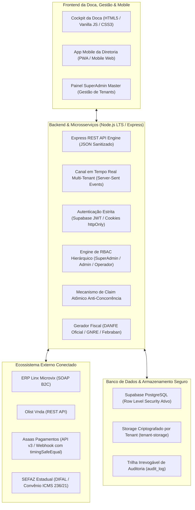
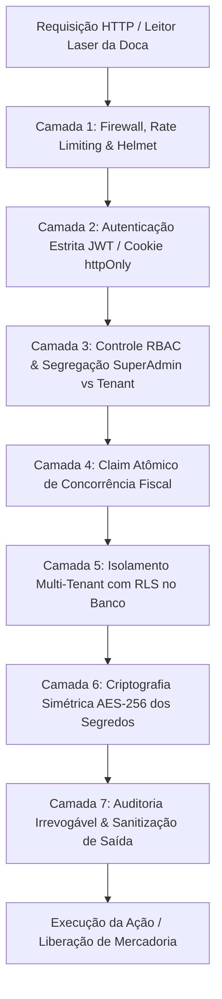

# 🛡️ ARQUITETURA TECNOLÓGICA & MANUAL DE SEGURANÇA (EXPEDI HUB)

> **Documento Oficial de Arquitetura, Engenharia & Segurança da Informação**  
> **Sistema:** expedi HUB (SaaS de Automação Fiscal e Portão de Expedição de Doca)  
> **Versão:** 2.4.0 (Hardening de Segurança & Isolamento Multi-Tenant Homologado)  
> **Data de Atualização:** 21 de Outubro de 2026  
> **Classificação:** Documento Técnico de Engenharia & Compliance

---

## 1. Stack Tecnológica (Backbone do Sistema)

O **expedi HUB** foi construído sob uma arquitetura de alta performance, projetada para suportar a velocidade exigida na doca física de expedição (leitura laser abaixo de 100ms) combinada com a integridade exigida pela legislação fiscal brasileira e a segregação estrita de dados em ambiente multi-tenant.



### 1.1. Tecnologias Principais

| Camada | Tecnologia / Biblioteca | Finalidade Operacional |
| :--- | :--- | :--- |
| **Runtime & Servidor** | **Node.js (LTS v24)** & **Express.js** | Servidor assíncrono não bloqueante de alta concorrência. |
| **Banco de Dados** | **PostgreSQL (via Supabase)** | Banco relacional com integridade referencial estrita e triggers fiscais. |
| **Segurança Multi-Tenant** | **Row Level Security (RLS)** | Isolamento lógico total entre empresas clientes no nível do banco. |
| **Armazenamento Seguro** | **Supabase Private Storage** | Guarda de XMLs, DANFEs, Comprovantes SISBACEN e Certificados A1. |
| **Tempo Real** | **SSE (Server-Sent Events)** | Notificação push instantânea para a doca com isolamento estrito por `tenant_id`. |
| **Renderização Fiscal** | **`pdf-lib`**, **`pdfkit`**, **`bwip-js`** | Cálculo e renderização nativa de vetores PDF, códigos **Code 128C** e **ITF (2 de 5)**. |
| **DANFE Oficial** | **`@mmachadosantos/nfe-danfe-pdf`** | Layout oficial SEFAZ para DANFE Simplificada A4 com protocolo de autorização. |
| **Compressão Contábil** | **`adm-zip`** | Geração em memória do pacote ZIP consolidado diário para auditoria. |
| **Criptografia** | **`crypto` (Nativo Node.js)** | Criptografia simétrica **AES-256-CBC** e comparação segura em tempo constante (`timingSafeEqual`). |
| **Proteção de Rede** | **`helmet`** & **`express-rate-limit`** | Proteção contra XSS, Clickjacking, MIME sniffing e ataques de força bruta. |

---

## 2. Mapa de Implementação de Segurança no Código

Todas as regras de segurança, autenticação e mitigação de vulnerabilidades estão centralizadas e auditáveis no código-fonte:

| Módulo / Recurso de Segurança | Arquivo de Origem | Referência / Função | Descrição Técnica |
| :--- | :--- | :--- | :--- |
| **Comparação em Tempo Constante** | [`server.js`](./server.js) | `safeCompareTokens()` | Compara tokens via `crypto.timingSafeEqual` para neutralizar ataques de timing. |
| **Autenticação Estrita (Sem Fail-Open)** | [`server.js`](./server.js) | `requireAuth` | Valida JWT via Supabase Auth. Rejeita requisições não autenticadas com HTTP 401. |
| **Hierarquia RBAC & SuperAdmin** | [`server.js`](./server.js) | `requireRole`, `requireSuperAdmin`, `requireAdmin` | Segrega acesso master da plataforma (`superadmin`), admins de loja (`admin`) e doca (`operador`). |
| **Isolamento de Canais SSE** | [`server.js`](./server.js) | `/api/events/dock`, `broadcastDockEvent()` | Atrela clientes SSE ao `tenantId` e filtra transmissões em tempo real por empresa. |
| **Sanitização de Dados Públicos** | [`server.js`](./server.js) | `/api/auth/me`, `/api/admin/tenants` | Oculta hashes, senhas e tokens criptografados; entrega apenas flags booleanas seguras. |
| **Proteção de Configurações Sensíveis** | [`server.js`](./server.js) | `/api/tenant/settings`, `upload-pfx`, `asaas-credentials` | Exige perfil `admin`, `superadmin` ou `diretoria` para troca de certificados e credenciais. |
| **Claim Atômico Anti-Concorrência** | [`server.js`](./server.js) | `/api/batch/authorize-payment-asaas`, `/api/guide/authorize-payment-asaas` | Trava a guia no banco com status `pagamento_em_processamento` antes de chamar o Asaas. |
| **Webhook Seguro com Tenant Escopado** | [`server.js`](./server.js) | `/api/webhooks/asaas` | Valida token com `safeCompareTokens`, atualiza guias com `.eq('tenant_id', ...)` e dispara SSE isolado. |
| **Políticas RLS no Banco de Dados** | [`schema.sql`](./schema.sql) | `CREATE POLICY ... ON ...` | Garante isolamento físico/lógico direto no motor do PostgreSQL. |
| **Trilha Irrevogável de Auditoria** | [`services/audit_service.js`](./services/audit_service.js) | `auditService.logAudit()` | Grava logs de eventos administrativos, acessos negados e autorizações fiscais. |

---

## 3. Modelo de Defesa em Profundidade (Defense-in-Depth)

A segurança do **expedi HUB** é estruturada em 7 camadas sequenciais de proteção:



---

### Camada 1: Proteção de Rede e Limitação de Taxa (Rate Limiting)
* **Prevenção de Ataques de Força Bruta:**
  * Rotas de autenticação (`/api/auth/login`) são limitadas a **30 tentativas a cada 15 minutos por IP**.
  * Rotas gerais de API são limitadas a **1.000 requisições a cada 15 minutos por IP**.
* **Proteção de Cabeçalhos HTTP (`Helmet`):**
  * Bloqueia injeção de scripts (XSS), protege contra sequestro de cliques (*Clickjacking*) e força uso estrito de tipos MIME.

---

### Camada 2: Autenticação Estrita sem Fallback Aberto (No Fail-Open)
* **Eliminação de Credenciais Fantasma:** Requisições sem credenciais não herdam permissões operacionais sob hipótese alguma. Caso o token JWT esteja ausente, corrompido ou expirado, o sistema rejeita imediatamente com `HTTP 401 Unauthorized` (ou redireciona navegadores para `/login.html`).
* **Canais de Autenticação Homologados:**
  * Cookie `httpOnly`, `SameSite=Lax`, válido por 7 dias (`sb_access_token`).
  * Header padrão `Authorization: Bearer <token>`.
  * Parâmetro de URL seguro `?token=<token>` (utilizado para conexões persistentes de EventSource/SSE e downloads de remessa).

---

### Camada 3: Controle RBAC Hierárquico e Segregação de Privilégios
O sistema estabelece limites rigorosos entre o administrador da plataforma SaaS e os administradores de lojas clientes:

```
[SuperAdmin Master] ───────> Gestão global de tenants, planos, métricas de faturamento e auditoria da plataforma
[Admin da Loja] ───────────> Gestão exclusiva de usuários da sua própria loja, certificado A1 e dados cadastrais
[Diretoria / Financeiro] ──> Autorização bancária de pagamentos de guias DIFAL no Asaas e fechamentos
[Operador de Doca] ────────> Leitura de código de barras, impressão de DANFEs/etiquetas e romaneios de carga
```

* **Blindagem Administrativa Global:** As rotas `/api/admin/*` (`metrics`, `tenants`, `create`, `status`, `plan`, `audit-logs`, `users`, `reset-password`) exigem compulsoriamente o middleware `requireSuperAdmin`. Nenhum administrador de loja consegue acessar métricas ou dados de outras empresas.
* **Proteção de Dados do Tenant:** Endpoints sensíveis de configuração (`/api/tenant/settings`, `/api/tenant/upload-pfx`, `/api/tenant/asaas-credentials`, `/api/tenant/plan`) são restritos a `requireRole(['admin', 'superadmin', 'diretoria'])`. Operadores de doca não têm permissão para alterar certificados ou credenciais financeiras.

---

### Camada 4: Claim Atômico Anti-Concorrência e Prevenção de Duplo Pagamento
Para liquidar guias no Asaas com segurança absoluta contra *race conditions* (por exemplo, quando dois diretores clicam simultaneamente no botão de pagamento ou há duplo clique na interface):

1. **Trava Atômica no Banco de Dados:** Antes de efetuar qualquer chamada externa à API bancária, o sistema executa um update condicional:
   ```javascript
   const { data: claimed } = await supabase
       .from('guides')
       .update({ status: 'pagamento_em_processamento', payment_authorized_at: agora })
       .eq('id', guia.id)
       .eq('tenant_id', tenant.id)
       .is('asaas_bill_id', null)
       .neq('status', 'pagamento_em_processamento')
       .neq('status', 'comprovada')
       .neq('status', 'paga')
       .select('id');
   ```
2. **Idempotência Garantida:** Se outra requisição simultânea já tiver travado a guia, a consulta retorna zero linhas modificadas e a requisição concorrente é descartada de imediato com aviso amigável, sem nunca chamar a API do Asaas duas vezes.
3. **Rollback de Segurança:** Caso ocorra erro de conectividade na API do Asaas durante o débito, a guia é imediatamente liberada de volta para status `pendente` com o motivo da recusa registrado para nova tentativa.

---

### Camada 5: Isolamento Multi-Tenant em Tempo Real (SSE da Doca)
* **Canais Privados por Tenant:** O endpoint SSE `/api/events/dock` exige autenticação prévia e registra o `tenantId` da conexão ativa (`res.tenantId = req.tenant.id`).
* **Broadcast Seletivo:** A função `broadcastDockEvent(payload, targetTenantId)` filtra ativamente os clientes conectados. Uma notificação de guia paga ou de erro gerada para uma loja **nunca é transmitida** para os terminais de doca de outra loja.

---

### Camada 6: Webhook do Asaas com Comparação em Tempo Constante
* **Proteção Contra Timing Attacks:** A verificação do token de webhook (`asaas-access-token`) é realizada via `crypto.timingSafeEqual`, impedindo que atacantes descubram o token por meio de discrepâncias de tempo de resposta.
* **Escopo Estrito de Atualização:** Qualquer alteração de status disparada pelo webhook filtra obrigatoriamente `.eq('id', guia.id).eq('tenant_id', guia.tenant_id)`, eliminando a possibilidade de mutação cruzada entre tenants.

---

### Camada 7: Criptografia AES-256 e Sanitização de DTOs

1. **Criptografia Simétrica em Repouso (AES-256-CBC):**
   * Senhas de Certificados A1 (`.pfx`) e chaves secretas bancárias são cifradas com chave mestra de 256 bits derivada via SHA-256 e vetor de inicialização (`IV`) randômico de 16 bytes a cada operação:
     $$\text{Ciphertext} = \text{AES-256-CBC}(\text{Segredo}, \text{Key}, \text{IV})$$
2. **Sanitização de Objetos de Resposta:**
   * Endpoints de perfil e listagem (`/api/auth/me` e `/api/admin/tenants`) nunca retornam hashes, chaves criptografadas ou tokens nos payloads JSON. O frontend recebe apenas indicadores booleanos de integridade (`has_pfx: true`, `has_asaas: true`, `has_microvix: false`).

---

## 4. Conformidade com a LGPD (Lei 13.709/2018)

O e-commerce lida com dados de consumidores finais (Nome, CPF, Endereço de Entrega, Telefone). O hub implementa conformidade estrita:

1. **Base Legal Fidedigna (Art. 7º, II e V da LGPD):**
   * O tratamento de dados pessoais é fundamentado no *Cumprimento de Obrigação Legal/Regulatória Fiscal* (emissão obrigatória de NF-e e GNRE perante a SEFAZ) e na *Execução de Contrato de Compra e Venda* (entrega de mercadoria ao destinatário pelo transportador).
2. **Minimização e Mascaramento Ativo:**
   * O serviço [`services/audit_service.js`](./services/audit_service.js) aplica mascaramento ativo para logs e telas analíticas:
     * CPF: `***.456.789-**`
     * Telefone: `(71) *****-1234`
     * E-mail: `m***s@dominio.com.br`
3. **Guarda Probatória Fiscal:**
   * Dados fiscais são mantidos pelo prazo decadencial obrigatório de **5 anos** (Código Tributário Nacional - Art. 173 e 174).

---

## 5. Trilha de Auditoria Irrevogável (`audit_log`)

Todas as ações de relevância operacional e fiscal são gravadas com carimbo de tempo inviolável na tabela `audit_log`:

```sql
CREATE TABLE audit_log (
    id UUID PRIMARY KEY DEFAULT gen_random_uuid(),
    tenant_id UUID REFERENCES tenants(id),
    user_id UUID,
    acao VARCHAR(100) NOT NULL,
    detalhe TEXT,
    ip_address VARCHAR(50),
    created_at TIMESTAMP WITH TIME ZONE DEFAULT timezone('utc'::text, now()) NOT NULL
);
```

* **Eventos Auditados em Tempo Real:**
  * `ACESSO_NEGADO_RBAC`: Tentativa de usuário acessar recurso além de seu perfil;
  * `ACESSO_NEGADO_SUPERADMIN`: Tentativa não autorizada de acessar rotas master do SaaS;
  * `AUTORIZAR_PAGAMENTO_LOTE`: Quem liberou o pagamento, qual lote e valor total;
  * `BLOQUEAR_EMPRESA` / `DESBLOQUEAR_EMPRESA`: Bloqueios manuais de licença;
  * `ALTERAR_PLANO`: Alterações de limites e planos de clientes;
  * `CRIAR_EMPRESA` e `CRIAR_USUARIO`: Criação de acessos ao sistema.

---

## 6. Checklist de Homologação para Produção

* [x] **Autenticação Segura:** `requireAuth` sem falha aberta, rejeitando qualquer requisição sem token válido.
* [x] **Isolamento de Canais:** SSE e broadcasts filtrados estritamente pelo `tenant_id` do cliente.
* [x] **Anti-Concorrência:** Claim atômico implementado em todos os fluxos de pagamento bancário Asaas.
* [x] **Resistência a Timing Attacks:** Validação de tokens de webhook via `crypto.timingSafeEqual`.
* [x] **Sanitização de Dados:** DTOs públicos sem exposição de hashes criptografados ou chaves privadas.
* [x] **RBAC Master:** Rotas `/api/admin/*` restritas a `requireSuperAdmin`.
* [x] **Variáveis de Ambiente:** `.env` protegido e nunca versionado no repositório Git.
* [x] **Comunicação Cifrada:** HTTPS/TLS obrigatório em todas as conexões externas.
* [x] **Certificados Digitais A1:** Senhas mantidas em repouso com cifragem militar AES-256-CBC.

---

*expedi HUB — Arquitetura Homologada para Alta Performance e Segurança Fiscal Enterprise.*
