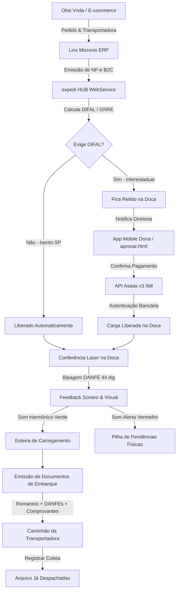

# 📦 expedi HUB — Portão Fiscal & Expedição Automatizada

> **Plataforma de Automação de DIFAL, Liquidação Bancária Asaas, Emissão de Romaneios e Liberação de Cargas na Doca**  
> *Cliente Piloto: Lalua Comércio de Modas / Boah (CNPJ: 10.436.619/0001-05)*

---

## 🎯 O Problema Resolvido

No e-commerce de moda interestadual (venda B2C pessoa física fora de SP), o recolhimento do **DIFAL (ICMS Partilha)** tradicionalmente gerava dois problemas graves:

1. **Retenção de Cargas em Postos Fiscais de Fronteira:** Caminhões de transportadoras (**Total Express**, **Correios**, **MT Log**) paravam na barreira da SEFAZ porque a guia GNRE ainda não havia sido paga ou compensada.
2. **Pagamentos em Duplicidade:** Para liberar o caminhão retido, a transportadora pagava a guia no posto fiscal e pedia reembolso. Dias depois, o financeiro rodava a remessa bancária e pagava a **mesma guia novamente**, causando descontrole de fluxo de caixa e bitributação.

### A Solução: expedi HUB
O **expedi HUB** transforma a expedição em um **Portão Fiscal Contínuo**:
* 🔒 **Alçada Segregada:** O operador na doca confere as caixas com leitor laser, mas **não possui acesso a fundos da empresa**. Ele separa a caixa retida e notifica a diretoria.
* 📱 **Aprovação Mobile:** A dona aprova a liquidação em **1 toque no smartphone** via conta Asaas.
* ⚡ **Liquidação Instantânea:** O Asaas quita a guia via código de barras com autenticação bancária SISBACEN em segundos.
* 📋 **Combo Documental:** Romaneio Oficial (A4 Paisagem) com assinatura de coleta + DANFE + Guia GNRE + Comprovante Bancário Asaas no mesmo maço.
* 🚚 **Despacho & Histórico:** Registro de coleta que arquiva cargas liberadas na aba de histórico e zera a doca ativa.

---

## 🔄 Fluxo Operacional & Arquitetura



---

## 🖥️ Telas e Recursos Principais

### 1. Cockpit do Portão Fiscal (`/dashboard.html`)
* **Header da Remessa:** Identifica a data da remessa, lote da doca e aviso de alçada exclusiva da diretoria.
* **4 Cards Semafóricos (Linear Style):** Cargas no Lote, Cargas Liberadas, Cargas Bloqueadas e DIFAL a Liquidar (R$).
* **Barra de Ação Unificada:**
  * Bipador de código de barras para etiquetas de DANFE (44 dígitos).
  * Botão `Documentos de Embarque` (Romaneio Oficial + DANFEs + Comprovantes).
  * Botão `Registrar Coleta (Despachar)` para arquivar cargas liberadas após o carregamento.
  * Menu `Mais Opções` com Fechamento Diário (.ZIP), Romaneio A4, Remessa CNAB 240, Upload de Retorno (.RET) e Devoluções & Crédito DIFAL.
* **Filtros Operacionais de 3 Níveis:**
  * **Data de Emissão:** `[Todas as Datas]`, `[Ontem (15/10)]` e `[Hoje (16/10)]`.
  * **Transportadora:** `[Todas]`, `[Total Express]`, `[Correios]`, `[MT Log]`.
  * **Situação:** `[Na Doca]`, `[🔴 Bloqueadas]`, `[🟢 Liberadas]`, `[Isento SP]`, `[🚚 Já Despachadas (Histórico)]`.
* **Modal Portão Fiscal (Bipagem na Doca):**
  * Ícone SEFAZ em linha fina.
  * Grid 2x2 com NF-e, Transportadora, Destino e DIFAL.
  * **Web Audio API:** Tom harmônico em Fá Maior (`523Hz` + `659Hz` + `784Hz`) para liberado e tom de alerta grave (`180Hz` + `135Hz`) para retido.

### 2. App Mobile da Diretoria (`/aprovar.html`)
* **Chassi de Smartphone:** Desenvolvido sob medida para visualização móvel em PWA.
* **Tipografia & Estilo:** Serifada de luxo *Playfair Display* e títulos dourados sobre fundo escuro.
* **Accordion por Transportadora:** Discriminando quantidades de caixas retidas e valor exato a pagar (Total Express, Correios, MT Log).
* **Ação Exclusiva:** Botão `"Confirmar Pagamento e Liberar Doca"` com feedback sonoro e visual instantâneo.

### 3. Gestão de Devoluções & Crédito DIFAL
* Modal integrado para vincular a NF-e de entrada emitida no Linx quando o consumidor devolve a mercadoria.
* Estorno contábil automático para evitar bitributação na SEFAZ e abater créditos fiscais do saldo devedor.

---

## 🛠️ Stack Tecnológico

* **Backend:** Node.js 18+, Express 4.19
* **Banco de Dados & Storage:** Supabase (PostgreSQL gerenciado + Storage para DANFEs e recibos SEFAZ)
* **Frontend:** Vanilla HTML5, CSS3 Moderno (Linear/Figma Dark & Light Design Systems), JavaScript ES6+
* **Áudio:** Web Audio API (Síntese nativa de harmônicos sem arquivos MP3 pesados)
* **APIs Integradas:**
  * **Linx Microvix:** WebService SOAP `B2CConsultaNFe`
  * **Olist Vnda:** REST API v2 de pedidos e transportadoras
  * **Asaas:** REST API v3 Pague Contas (`/v3/bill`) com autenticação SISBACEN
  * **Portal GNRE Nacional & SEFAZ-ES:** mTLS SOAP com Certificado Digital A1

---

## 🚀 Como Executar Localmente

### Pré-requisitos:
* Node.js v18 ou superior instalado.
* Arquivo `.env` configurado com as chaves do Supabase e credenciais de integração.

### Instalação & Execução:

```bash
# 1. Clonar o repositório
git clone https://github.com/jrobertodasc-cmd/Hub_automa-o.git
cd Hub_automa-o

# 2. Instalar dependências
npm install

# 3. Executar o servidor localmente
npm run dev
```

O servidor iniciará escutando em **`http://localhost:3001`**.

---

## 🧭 Principais Rotas e Páginas

| Rota | Tipo | Descrição |
| :--- | :---: | :--- |
| `/dashboard.html` | Frontend | Cockpit da Doca com bipador laser, tabela de cargas e filtros |
| `/aprovar.html` | Frontend | App Mobile da Dona para aprovação de pagamentos |
| `/login.html` | Frontend | Tela de login corporativo do expedi HUB |
| `/profile.html` | Frontend | Configurações de credenciais Asaas e WhatsApp privado |
| `/api/expedicao/romaneio` | API | Emissão do Romaneio Oficial de Coleta em A4 Paisagem |
| `/api/expedicao/combo/:batchId` | API | Pacote documental 3-em-1 (Romaneio + DANFE + Guia + Comprovante) |
| `/api/fechamento/pacote-zip/:batchId` | API | Download do pacote de fechamento diário e conciliação contábil |
| `/api/webhooks/asaas` | Webhook | Receptor de confirmação de liquidação bancária Asaas |

---

## 📚 Documentação Complementar

* [MANUAL_PORTAO_FISCAL_EXPEDICAO.md](file:///c:/Users/Roberto/Desktop/Web_Services/MANUAL_PORTAO_FISCAL_EXPEDICAO.md): Guia operacional passo a passo para operadores e financeiro.
* [RESUMO_CONTEXTO_CONTINUIDADE.md](file:///c:/Users/Roberto/Desktop/Web_Services/RESUMO_CONTEXTO_CONTINUIDADE.md): Contexto histórico, pendências resolvidas e roadmap para próximos passos.
* [PANORAMA_PROJETO.md](file:///c:/Users/Roberto/Desktop/Web_Services/PANORAMA_PROJETO.md): Radiografia estática profunda de arquitetura, banco de dados e componentes legados.

---

*expedi HUB — Tecnologia para Logística Fiscal de Alta Performance.*
