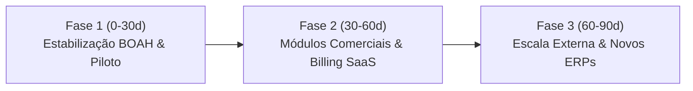

# 🧭 PLANO ESTRATÉGICO DE PRODUTO: expedi HUB (v2.0)
### Da Operação Âncora na BOAH à Escala de Plataforma SaaS de Gestão Comercial e Fiscal

---

## 1. SUMÁRIO EXECUTIVO PARA A COORDENAÇÃO

O **expedi HUB** é uma plataforma que unifica o **Portão Fiscal / Expedição**, a **Inteligência Comercial Omnichannel (Social Selling & E-commerce)** e a **Conciliação Financeira de Tributos Interestaduais (DIFAL / GNRE / SEFAZ)**.

### Proposta de Valor Imediata para a BOAH:
1. **Eliminação de Retenção de Cargas em Barreiras Fiscais:** Emissão e liquidação automatizada de guias DIFAL/GNRE/DARE com geração antecipada de DANFE e código de barras antes do despacho.
2. **Visão Comercial Unificada (VNDA + Linx Microvix):** Cruzamento em tempo real do faturamento do ERP físico com os pedidos do storefront digital, calculando GMV real, ticket médio, margem de contribuição e ranking de vendas de consultoras por cupons e canais de Social Selling.
3. **Redução Drástica do Custo Operacional:** Automação de tarefas repetitivas do setor fiscal e da expedição, liberando os analistas para atividades estratégicas.

---

## 2. VIABILIDADE: O SISTEMA JÁ É SAAS MULTI-TENANT?

| Critério Arquitetural | Status Atual | Detalhamento Técnico |
| :--- | :---: | :--- |
| **Isolamento de Dados (Multi-Tenant)** | **APROVADO** | Cada cliente possui um `tenant_id` exclusivo indexado em todas as tabelas operacionais (`guides`, `batches`, `audit_log`, `invoice_items`). |
| **Segurança & Proteção de Credenciais** | **APROVADO** | Chaves de API (VNDA, Microvix, Asaas) e senhas de certificados A1 são criptografadas com **AES-256**. |
| **Auditoria & RBAC** | **APROVADO** | Perfis de acesso restritos (`diretoria`, `financeiro`, `operador`, `admin`). Todas as ações de liquidação gravam trilha de auditoria com IP e timestamp. |
| **Integridade de Métricas do BI** | **APROVADO** | Zero dados fictícios ou estimativas hardcoded. Quando um tenant não possui dados ou integrações, o sistema exibe indicadores zerados e solicita conexão. |
| **Configuração Comercial por Tenant** | **APROVADO** | Cupons institucionais da marca, aliases de consultoras Linx e classificação de campanhas são configuráveis via interface e API dedicada. |
| **Billing Recorrente Automático** | *Roadmap (60d)* | Atualmente a ativação de planos é realizada administrativamente pelo SuperAdmin; cobrança automatizada via cartão/PIX recorrente prevista na Fase 2. |

> **Conclusão:** O sistema possui arquitetura completa para operar como **SaaS**, sendo a **BOAH a operação âncora (piloto homologado com dados reais)** e com segurança absoluta para a entrada gradual de novos clientes sem vazamento de dados.

---

## 3. ADERÊNCIA À GESTÃO COMERCIAL DE UM E-COMMERCE

### O que o expedi HUB já entrega com dados 100% auditáveis:
* **Faturamento Real & Pedidos:** Conexão direta com a API Olist VNDA trazendo status (`confirmed`, `canceled`), itens, preços, canais e fretes.
* **Inteligência de Social Selling & Vendedoras:** Identificação de consultoras através de agentes explícitos no Linx Microvix ou cupons nominais da VNDA, gerando ranking de receita, volume de pedidos e ticket médio por consultora.
* **Desempenho de Campanhas Promocionais:** Auditoria da taxa de penetração de cupons no faturamento bruto, segmentando entre cupons de influenciadoras, primeira compra, campanhas sazonais e consultoras.
* **Curva de Clientes VIP (LTV & Frequência):** Identificação dos maiores compradores por volume financeiro e reincidência de compra.
* **DRE Operacional Estimado:** Cálculo da Margem de Contribuição após dedução de DIFAL estadual, CMV estimado e taxas de meios de pagamento (Cartão/PIX).
* **Exportação Analítica Unificada (Power BI / Excel):** Base com 25 colunas normalizadas (`.csv` com BOM UTF-8) integrando dados fiscais da nota com dados de carrinho e logística.

---

## 4. CRONOGRAMA EXECUTIVO: ROADMAP 30 / 60 / 90 DIAS

### 🗓️ FASE 1: 0 a 30 DIAS — Consolidação da Operação Âncora na BOAH
* **Objetivo:** Garantir 100% de precisão operacional e fluidez no dia a dia da expedição e do financeiro da BOAH.
* **Entregas Principais:**
  1. **Doca Fiscal em Produção:** Homologação do fluxo de bipagem de código de barras e conferência de romaneio de carga para Total Express e Correios.
  2. **Liquidação Automática via Asaas:** Ativação do webhook de liquidação de guias DIFAL, com download automático de comprovantes bancários oficiais para o storage.
  3. **Migração de Banco de Dados:** Execução do script SQL de suporte à coluna `settings` (JSONB) no Supabase para salvar as configurações de cupons e consultoras pela interface gráfica.
  4. **Painel de Configurações Comerciais no Ar:** Treinamento da equipe comercial da BOAH para cadastrar cupons de novas consultoras e campanhas sazonais direto na tela de Configurações.

---

### 🗓️ FASE 2: 30 a 60 DIAS — Maturação de Recursos Comerciais & SaaS Engine
* **Objetivo:** Adicionar ferramentas de gestão comercial profunda e automatizar o ciclo de cobrança do software.
* **Entregas Principais:**
  1. **Gestão de Metas Comerciais:** Definição de meta mensal de GMV e meta individual por vendedora, com régua de projeção (Run Rate) e alerta de atingimento de metas.
  2. **Monitoramento de Ruptura de Estoque (Top Sellers):** Alerta no painel quando itens da Curva A estiverem com estoque crítico no Linx Microvix para evitar perda de vendas no e-commerce.
  3. **Motor de Assinaturas e Cobrança Automática do SaaS:** Integração com gateway de pagamentos para cobrança de mensalidade dos planos (`Starter`, `Pro`, `Advanced`) com suspensão e reativação automática via webhook.
  4. **Onboarding Self-Service de Novos Clientes:** Assistente passo a passo para que novas marcas configurem CNPJ, Certificado A1 e tokens de loja em menos de 10 minutos.

---

### 🗓️ FASE 3: 60 a 90 DIAS — Expansão Multicanal & Abertura ao Mercado
* **Objetivo:** Transformar o expedi HUB no ecossistema padrão para e-commerces de moda e varejo em todo o Brasil.
* **Entregas Principais:**
  1. **Conectores Nativos para Plataformas Líderes:**
     * ERPs: Bling, Tiny e Omie.
     * Plataformas de E-commerce: Shopify, VTEX e Tray.
  2. **Marketing Attribution (Meta Ads / Google Ads):** Importação de custos de mídia paga para cruzamento com faturamento da VNDA, calculando ROAS real e CAC por canal.
  3. **Portal do Fornecedor / Transportadoras:** Acesso restrito para parceiros logísticos visualizarem romaneios e status de liberação fiscal de cargas sem necessidade de envio manual de planilhas.

---

## 5. BENEFÍCIOS IMEDIATOS PARA APRESENTAR À DIRETORIA

1. **Risco Zero:** A BOAH utiliza um sistema desenvolvido e testado sob medida para a sua realidade fiscal (Bahia / SEFAZ nacional) e de e-commerce (VNDA + Linx).
2. **Economia de Escala:** A evolução do software como produto SaaS garante que melhorias tecnológicas constantes e atualizações tributárias da Reforma Tributária sejam incorporadas continuamente sem custos de consultoria avulsa.
3. **Governança e Confiabilidade:** Auditoria total de ponta a ponta: do momento em que o cliente clica em "Comprar" no site até a mercadoria ser conferida no caminhão com a guia fiscal paga e comprovada.
