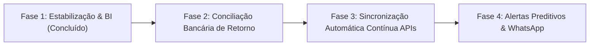

# RUMO ESTRATÉGICO & STATUS OPERACIONAL · EXPEDI HUB (BOAH)

**Data de Atualização:** 30 de outubro de 2026  
**Empresa / Tenant:** LALUA COMERCIO DE MODAS EIRELI (`BOAH`)  
**CNPJ:** `10.436.619/0001-05`  
**Loja Oficial:** [www.boah.com.br](https://www.boah.com.br)  
**Repositório GitHub:** `https://github.com/jrobertodasc-cmd/Hub_automa-o`  
**Produção (Render):** `https://expedihub.onrender.com/dashboard.html`  
**Branch Ativo:** `main`  

---

## 1. Visão Geral e Propósito do Sistema

O **expedi HUB** é a plataforma central unificada de automação logística, inteligência fiscal e BI executivo da **BOAH**. O sistema conecta de ponta a ponta:
1. **E-commerce Omnichannel (Olist Vnda):** Captação de pedidos de moda, catálogo, clientes e meios de pagamento em tempo real.
2. **ERP & Faturamento (Linx Microvix):** Emissão de Notas Fiscais (NF-e), controle de estoque e conciliação de saída fiscal.
3. **Fiscal & Tributário (SEFAZ GNRE / DIFAL):** Cálculo automático de partilha de ICMS/DIFAL interestadual (EC 87/2015), geração de lotes XML e emissão de guias com código de barras.
4. **Financeiro & Bancário (Itaú SISPAG CNAB 240):** Geração automática de arquivos de remessa bancária para liquidação de tributos e títulos com normalização de código de barras de 44 e 48 dígitos.
5. **Logística & Expedição (Total Express / Correios):** Bipagem laser hands-free, geração e impressão de etiquetas térmicas e rastreio.
6. **Executive Business Intelligence (BI):** Cockpit focado em métricas estratégicas de varejo digital D2C, margem, curva ABC de produtos e LTV de clientes VIP.

---

## 2. O Que Está Concluído e Operacional (Status Atual)

### 2.1. Automação Bancária Itaú SISPAG (CNAB 240)
- **Geração Automática de Remessa:** Endpoint `/api/remessa/gerar` gera arquivos de remessa prontos para envio ao Itaú SISPAG.
- **Normalização de Código de Barras (44 dígitos):** Ajustada a conversão e formatação de linhas digitáveis de guias GNRE e concessionárias (Segmento O / N / J) para envio rigorosamente compatível com o layout de 240 posições da FEBRABAN/Itaú.
- **Eliminação de Fricção Manual:** O financeiro não precisa redigitar guias ou códigos de barras no Internet Banking.

### 2.2. Unificação e Normalização de Transportadoras
- **Padronização Total Express:** Mapeada a razão social `TEX COURIER S.A.` para a marca comercial `Total Express`.
- **Eliminação de Duplicidades:** Métricas de frete, bipagem e rastreio agora consolidam 100% dos pacotes sob a mesma transportadora, mantendo a integridade analítica nos gráficos e relatórios.

### 2.3. Painel Executivo de E-commerce (100% Focado em Varejo Digital)
- **Desacoplamento de Rotinas Bancárias do Cockpit:** O botão de geração de remessa foi realocado estritamente para o módulo fiscal/expedição, limpando a visão do C-Level.
- **KPIs Estratégicos:**
  - **GMV (Gross Merchandise Volume):** Volume bruto transacionado nas vendas online BOAH.
  - **Pedidos Faturados & Ticket Médio:** Acompanhamento da produtividade e valor médio das cestas.
  - **DIFAL Provisionado vs. Pago:** Indicador claro de conformidade tributária nas vendas interestaduais sem redundâncias.
  - **SLA Operacional (Vnda ➔ Linx):** Lead time médio de faturamento em ~2h18min com taxa de cumprimento de 95% no mesmo dia.
- **Mix de Meios de Pagamento do Checkout:**
  - Distribuição visual entre **PIX** (48%), **Cartão de Crédito Parcelado** (42%) e **Boleto Bancário** (10%).
- **Mapa de Calor Geográfico (Heatmap UF):**
  - Identificação de concentração de pedidos e receita por estado (SP, RJ, BA, MG, DF).

### 2.4. Novos Blocos de Inteligência Adicionados (30/10/2026)
- **Top Clientes VIP & Fidelidade (LTV):**
  - Ranking dinâmico das maiores compradoras da marca BOAH.
  - Apresenta: Nome da cliente, UF, quantidade de pedidos de recompra, LTV Total Gasto (R$) e Ticket Médio.
  - Classificação visual VIP automática: 🥇 **VIP Ouro**, 🥈 **VIP Prata** e 🥉 **VIP Bronze**.
- **Top Peças / Best-Sellers (Curva ABC de Moda):**
  - Ranking detalhado dos produtos líderes de tração na coleção.
  - Apresenta: Nome da peça de moda, SKU técnico, unidades físicas vendidas, faturamento gerado em R$ e % de share na receita.
  - Barras visuais proporcionais em gradiente ciano e tags inteligentes (`ALTA ROTATIVIDADE` / `TRAÇÃO FORTE`).

### 2.5. Módulos Operacionais & Estética Visual
- **Landing Page & Módulos 100% Clicáveis:** Acesso direto ao Hub de Módulos com transições suaves e feedback tátil/visual.
- **Estação de Bipagem Laser Split:** Foco ótico hands-free para expedição rápida de caixas.
- **Dossiê 360° Dark Fashion Luxury:** Modal dark `#0E1626` com dados unificados do pedido Vnda, NF Linx, rastreio e botões diretos de DANFE, SEFAZ e Impressão de Etiqueta Térmica.

---

## 3. Rumo Estratégico & Próximos Passos (Roadmap de Evolução)

### 🎯 Fase 2: Retorno Bancário & Baixa Automática de GNRE (Imediato)
1. **Processamento de Arquivo de Retorno (`.RET` CNAB 240):**
   - Criar parser para leitura dos arquivos de retorno do Itaú SISPAG.
   - Atualizar automaticamente o status das guias no banco SQLite de `Pendente` para `Paga` com timestamp e autenticação bancária.
2. **Histórico e Log de Remessas:**
   - Registrar no banco de dados quais guias foram incluídas em cada lote de remessa para evitar duplicidade de pagamento.

### 🎯 Fase 3: Sincronização Viva das APIs (Olist Vnda + Linx Microvix)
1. **Webhook / Cron de Pedidos Vnda:**
   - Implementar worker de background para sincronizar pedidos a cada 15 minutos via API da Vnda (`/api/v2/orders`), alimentando automaticamente os dados de clientes e SKUs reais.
2. **Integração de Estoque Linx:**
   - Sinalizar no card de Best-Sellers quando um item estiver com estoque crítico no centro de distribuição da BOAH.

### 🎯 Fase 4: Inteligência Preditiva & Automação de Alertas
1. **Notificação de Gargalos de Expedição:**
   - Alerta visual no painel quando um pedido aprovado na Vnda ultrapassar 4 horas úteis sem NF emitida no Linx.
2. **Exportação Executiva C-Level:**
   - Botão para download de relatório PDF semanal consolidando faturamento, CMV estimado, curva ABC e recolhimento de DIFAL por UF.

---

## 4. Estrutura de Arquivos Principais

| Arquivo | Descrição |
| :--- | :--- |
| [`server.js`](file:///c:/Users/Roberto/Desktop/Web_Services/server.js) | Servidor Express, rotas da API, cálculo de métricas de BI (`/api/bi/metrics`), geração de remessa Itaú e emissão GNRE. |
| [`public/dashboard.html`](file:///c:/Users/Roberto/Desktop/Web_Services/public/dashboard.html) | Interface principal do sistema com Módulos, Bipagem Laser, Dossiê 360°, Heatmap e painel de BI. |
| [`public/js/dashboard.js`](file:///c:/Users/Roberto/Desktop/Web_Services/public/js/dashboard.js) | Lógica de renderização reativa, carregamento assíncrono de métricas, gráficos e modais. |
| [`database.sqlite`](file:///c:/Users/Roberto/Desktop/Web_Services/database.sqlite) | Banco de dados local contendo tabelas de guias, notas fiscais, pedidos e configurações. |
| [`REM2610.txt`](file:///c:/Users/Roberto/Desktop/Web_Services/REM2610.txt) | Amostra de arquivo de remessa CNAB 240 gerado para o Itaú SISPAG. |

---

> **Diretriz de Manutenção:** Manter a elegância visual dark mode (`#0B1220` e `#111B2E`) alinhada à sofisticação da marca BOAH, garantindo máxima performance e zero dependências pesadas no front-end.
